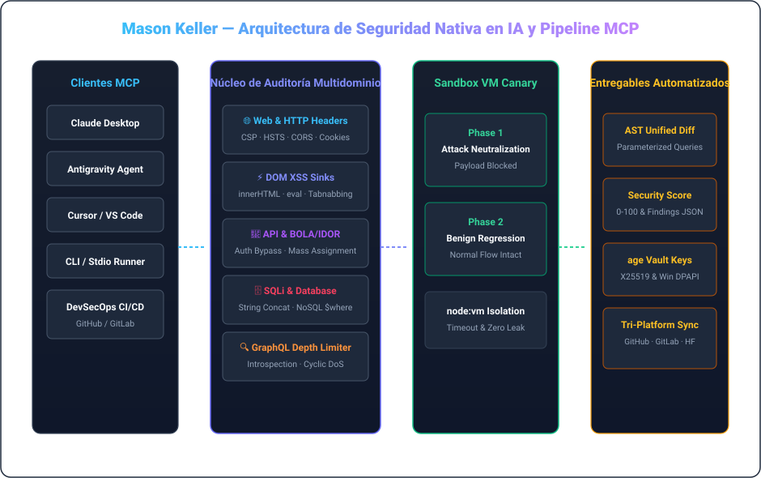

  <a href="./README.md">🇺🇸 English</a> &nbsp;•&nbsp; <a href="./README.ko.md">🇰🇷 한국어</a> &nbsp;•&nbsp; <a href="./README.ja.md">🇯🇵 日本語</a> &nbsp;•&nbsp; <a href="./README.zh.md">🇨🇳 简体中文</a> &nbsp;•&nbsp; <strong>🇪🇸 Español</strong> 
  <a href="./README.fr.md">🇫🇷 Français</a> &nbsp;•&nbsp; <a href="./README.de.md">🇩🇪 Deutsch</a> &nbsp;•&nbsp; <a href="./README.ru.md">🇷🇺 Русский</a> &nbsp;•&nbsp; <a href="./README.pt-BR.md">🇧🇷 Português</a> &nbsp;•&nbsp; <a href="./README.ar.md">🇸🇦 العربية</a>

  

 

### 💡 Resumen Ejecutivo (Executive Overview)

Hola, soy **Mason Keller** — Ingeniero de seguridad nativo de IA y arquitecto de sistemas especializado en auditoría automatizada de vulnerabilidades, síntesis de parches defensivos a nivel AST, protocolos MCP e infraestructura criptográfica moderna.

Diseño arquitecturas donde la **auditoría proactiva de seguridad se integra con la remediación defensiva automatizada**: desde servidores MCP de alta confiabilidad hasta entornos aislados de pruebas canarias y bóvedas criptográficas poscuánticas.

---

  

### 🏛️ Pilares de Ingeniería y Arquitecturas Centrales

#### 1. 🛡️ Investigación de Vulnerabilidades con IA y Parches AST
- **Auditoría de Seguridad Multidominio**: Inspección profunda de cabeceras HTTP (CSP, HSTS, CORS), sumideros DOM XSS, endpoints REST/GraphQL (BOLA/IDOR) e inyecciones SQL.
- **Reescritura de Código AST**: Síntesis programática de consultas parametrizadas, saneamiento DOM e inyección de middleware defensivo.
- **Defensa GraphQL**: Control de profundidad de consultas para mitigar DoS cíclicos y bloqueo de introspección en producción.

#### 2. ⚡ Model Context Protocol (MCP) y Runtimes de Agentes
- **Orquestación de Herramientas IA**: Implementación estricta de la especificación MCP v1.0 sobre transportes stdio y SSE con validación Zod.
- **Sandbox Canary de Doble Fase**: Validación en entorno aislado verificando bloqueo de exploits y prevención de regresiones.
- **Supervisión de Procesos**: Tolerancia a fallos, contención de timeouts y política Zero-Zombie.

#### 3. 🔐 Seguridad Criptográfica y Bóvedas Poscuánticas
- **Criptografía Filosofía UNIX**: Uso de `age` (X25519) y firmas desacopladas Minisign (Ed25519).
- **Protección Híbrida Poscuántica**: Encapsulación de claves ML-KEM-768 (Kyber) para máxima confidencialidad.
- **Aislamiento Ligado al Hardware**: Cifrado Windows DPAPI garantizando cero fugas en texto plano.

---

### 💻 Pila Tecnológica y Herramientas

| Domain | Core Technologies &amp; Tooling |
| :--- | :--- |
| **Languages &amp; Runtimes** | `TypeScript`, `Node.js`, `Rust`, `Go`, `Python`, `Shell (Bash / PowerShell)`, `SQL` |
| **AI Protocols &amp; MCP** | `Model Context Protocol (MCP v1.0)`, `Stdio / SSE Transports`, `Zod Schema Validation`, `Tool Orchestration` |
| **Defensive Security &amp; Auditing** | `OWASP Top 10`, `CSP / HSTS / CORS Headers`, `DOM XSS Sinks`, `BOLA / IDOR Analysis`, `SQLi AST Parameterization` |
| **Sandbox &amp; Execution Isolation** | `Node.js node:vm Sandboxing`, `Dual-Phase Canary Execution`, `Regression Verification`, `Timeout Guarding` |
| **Cryptography &amp; Secrets** | `age (X25519) UNIX Encryption`, `Minisign (Ed25519)`, `Post-Quantum (ML-KEM-768 / Kyber)`, `Windows DPAPI` |
| **CI/CD &amp; Multi-Platform Sync** | `GitHub Actions`, `Tri-Platform Mirroring (GitHub · GitLab · Hugging Face)`, `SemVer Releases` |

---

### 📁 Sistemas Destacados y Repositorios

- **[`vulnforge-mcp`](https://github.com/mason-keller/vulnforge-mcp)** — Universal AI-Native Web, API &amp; Database Vulnerability Auditing with Automated Patch Injection MCP Server (v1.2.0). Features 7 core MCP tools, AST query parameterization, and isolated VM canary testing.
- **[`canary-sandbox-engine`](https://github.com/mason-keller/vulnforge-mcp)** — Lightweight VM-isolated dual-phase execution sandbox that verifies attack payload neutralization and guarantees zero functional regression before applying patches.
- **[`crypto-vault-age`](https://github.com/mason-keller/vulnforge-mcp)** — UNIX-philosophy cryptographic protection suite combining age (X25519), Ed25519 detached signatures, and Windows DPAPI hardware binding.
- **[`devsecops-pipeline`](https://github.com/mason-keller/vulnforge-mcp)** — Automated multi-platform mirroring and real-time dependency auditing across GitHub, GitLab, and Hugging Face.

---

  

    
  <i>"La seguridad no es un parche aplicado a posteriori; es un invariante fundamental de la arquitectura de software."</i>

