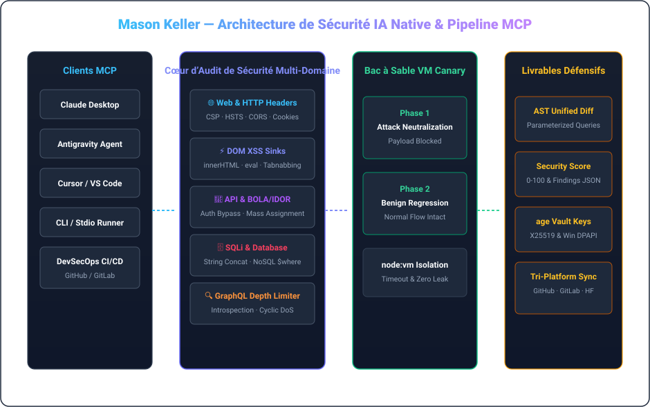

  <a href="./README.md">🇺🇸 English</a> &nbsp;•&nbsp; <a href="./README.ko.md">🇰🇷 한국어</a> &nbsp;•&nbsp; <a href="./README.ja.md">🇯🇵 日本語</a> &nbsp;•&nbsp; <a href="./README.zh.md">🇨🇳 简体中文</a> &nbsp;•&nbsp; <a href="./README.es.md">🇪🇸 Español</a> 
  <strong>🇫🇷 Français</strong> &nbsp;•&nbsp; <a href="./README.de.md">🇩🇪 Deutsch</a> &nbsp;•&nbsp; <a href="./README.ru.md">🇷🇺 Русский</a> &nbsp;•&nbsp; <a href="./README.pt-BR.md">🇧🇷 Português</a> &nbsp;•&nbsp; <a href="./README.ar.md">🇸🇦 العربية</a>

  

 

### 💡 Vue d’Ensemble Executive (Executive Overview)

Bonjour, je suis **Mason Keller** — Ingénieur en sécurité IA-native et architecte système, spécialisé dans l’audit automatisé des vulnérabilités, la synthèse de correctifs défensifs par AST, le protocole MCP et la cryptographie moderne.

Je conçois des systèmes où **la sécurité offensive rencontre la remédiation défensive automatisée** : des serveurs de sécurité MCP haute assurance aux bacs à sable d’exécution canari et coffres-forts cryptographiques post-quantiques.

---

  

### 🏛️ Piliers d’Ingénierie & Architectures Fondamentales

#### 1. 🛡️ Recherche de Vulnérabilités IA & Synthèse de Patchs AST
- **Audit Multi-Domaines**: Analyse approfondie des en-têtes HTTP, puits DOM XSS, vulnérabilités BOLA/IDOR et injections SQL.
- **Réécriture de Code AST**: Synthèse automatisée de requêtes paramétrées, assainissement du DOM et génération de diffs unifiés.
- **Protection GraphQL**: Limitation de la profondeur des requêtes contre les attaques DoS et masquage de l’introspection.

#### 2. ⚡ Model Context Protocol (MCP) & Moteurs d’Agents Autonomes
- **Intégration d’Outils IA**: Implémentation stricte des spécifications MCP v1.0 avec validation de schémas Zod.
- **Bac à Sable Canari en Deux Phases**: Vérification sous VM isolée du blocage des attaques et de l’absence de régression.
- **Supervision et Stabilité**: Garantie de cycle de vie sans processus zombies et isolation stricte.

#### 3. 🔐 Rigueur Cryptographique & Coffre-Fort Post-Quantique
- **Chiffrement Philosophie UNIX**: Utilisation de `age` (X25519) et Minisign (Ed25519) pour la haute sécurité.
- **Protection Hybride Post-Quantique**: Encapsulation de clé ML-KEM-768 (Kyber) pour la confidentialité pérenne.
- **Isolation Liée au Matériel**: Protection Windows DPAPI interdisant toute fuite de clés en clair.

---

### 💻 Stack Technologique Complète

| Domain | Core Technologies &amp; Tooling |
| :--- | :--- |
| **Languages &amp; Runtimes** | `TypeScript`, `Node.js`, `Rust`, `Go`, `Python`, `Shell (Bash / PowerShell)`, `SQL` |
| **AI Protocols &amp; MCP** | `Model Context Protocol (MCP v1.0)`, `Stdio / SSE Transports`, `Zod Schema Validation`, `Tool Orchestration` |
| **Defensive Security &amp; Auditing** | `OWASP Top 10`, `CSP / HSTS / CORS Headers`, `DOM XSS Sinks`, `BOLA / IDOR Analysis`, `SQLi AST Parameterization` |
| **Sandbox &amp; Execution Isolation** | `Node.js node:vm Sandboxing`, `Dual-Phase Canary Execution`, `Regression Verification`, `Timeout Guarding` |
| **Cryptography &amp; Secrets** | `age (X25519) UNIX Encryption`, `Minisign (Ed25519)`, `Post-Quantum (ML-KEM-768 / Kyber)`, `Windows DPAPI` |
| **CI/CD &amp; Multi-Platform Sync** | `GitHub Actions`, `Tri-Platform Mirroring (GitHub · GitLab · Hugging Face)`, `SemVer Releases` |

---

### 📁 Systèmes et Dépôts Remarquables

- **[`vulnforge-mcp`](https://github.com/mason-keller/vulnforge-mcp)** — Universal AI-Native Web, API &amp; Database Vulnerability Auditing with Automated Patch Injection MCP Server (v1.2.0). Features 7 core MCP tools, AST query parameterization, and isolated VM canary testing.
- **[`canary-sandbox-engine`](https://github.com/mason-keller/vulnforge-mcp)** — Lightweight VM-isolated dual-phase execution sandbox that verifies attack payload neutralization and guarantees zero functional regression before applying patches.
- **[`crypto-vault-age`](https://github.com/mason-keller/vulnforge-mcp)** — UNIX-philosophy cryptographic protection suite combining age (X25519), Ed25519 detached signatures, and Windows DPAPI hardware binding.
- **[`devsecops-pipeline`](https://github.com/mason-keller/vulnforge-mcp)** — Automated multi-platform mirroring and real-time dependency auditing across GitHub, GitLab, and Hugging Face.

---

  

    
  <i>"La sécurité n’est pas un correctif appliqué après coup ; c’est un invariant fondamental de l’architecture logicielle."</i>

