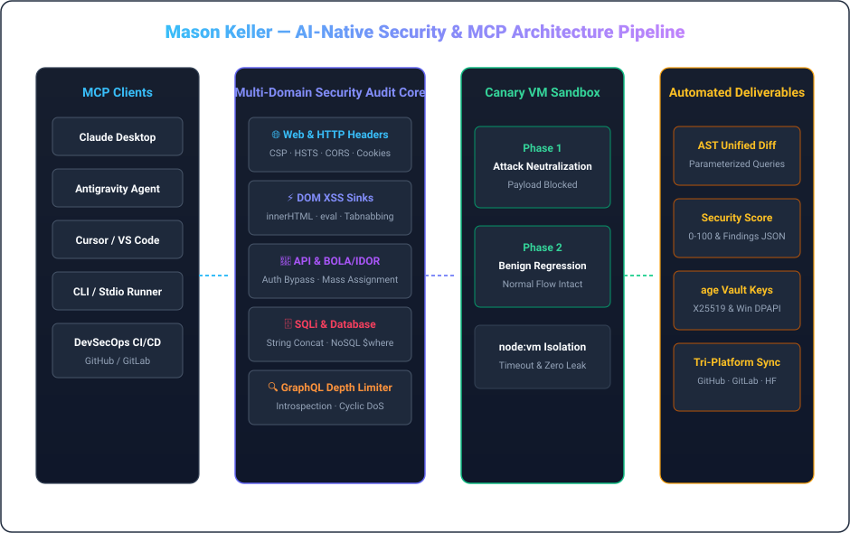

  <strong>🇺🇸 English</strong> &nbsp;•&nbsp; <a href="./locales/README.ko.md">🇰🇷 한국어</a> &nbsp;•&nbsp; <a href="./locales/README.ja.md">🇯🇵 日本語</a> &nbsp;•&nbsp; <a href="./locales/README.zh.md">🇨🇳 简体中文</a> &nbsp;•&nbsp; <a href="./locales/README.es.md">🇪🇸 Español</a> 
  <a href="./locales/README.fr.md">🇫🇷 Français</a> &nbsp;•&nbsp; <a href="./locales/README.de.md">🇩🇪 Deutsch</a> &nbsp;•&nbsp; <a href="./locales/README.ru.md">🇷🇺 Русский</a> &nbsp;•&nbsp; <a href="./locales/README.pt-BR.md">🇧🇷 Português</a> &nbsp;•&nbsp; <a href="./locales/README.ar.md">🇸🇦 العربية</a>

  

 

### 💡 Executive Overview

Hi, I am **Mason Keller** — an AI-Native Security Engineer & Systems Architect specializing in automated vulnerability auditing, AST-level defensive patch synthesis, Model Context Protocol (MCP) ecosystems, and cryptographic data integrity.

I design systems where **offensive-aware security meets automated defensive remediation**: from high-assurance MCP security servers inspecting web headers and DOM sinks to isolated canary execution sandboxes and quantum-resistant cryptographic key vaults.

---

  

### 🏛️ Engineering Pillars & Core Architectures

#### 1. 🛡️ AI-Native Vulnerability Research & AST Patch Synthesis
- **Multi-Domain Security Auditing**: Deep inspection of HTTP headers (CSP, HSTS, CORS), DOM XSS sinks (`innerHTML`, `eval`), REST/GraphQL BOLA/IDOR vectors, and SQLi string concatenation.
- **Automated AST Code Rewriting**: Programmatic synthesis of defensive mitigations (parameterized queries, DOM sanitization, security middleware injection) with unified diff generation.
- **GraphQL Depth & Introspection Defense**: Automatic prevention of cyclic selection-set DoS bombs, alias abuse, and unconditioned production schema leaks.

#### 2. ⚡ Model Context Protocol (MCP) & Autonomous Agent Runtimes
- **Standardized AI Tool Integration**: High-assurance MCP v1.0 implementations over stdio and SSE transports with strict Zod schema validation.
- **Dual-Phase Canary Sandboxing**: Isolated `node:vm` execution harness testing synthesized patches against real attack payloads while verifying zero functional regressions.
- **Agent Governance & Supervisors**: Robust process monitoring, timeout containment, and zero-leak execution policies.

#### 3. 🔐 Cryptographic Assurance, Zeroize & Quantum-Resistant Vaults
- **UNIX-Philosophy Encryption**: Deployment of `age` (X25519) and Minisign (Ed25519) for detached signature verification and high-assurance binary releases.
- **Post-Quantum Hybrid Readiness**: Integration of ML-KEM-768 (Kyber) key encapsulation for future-proof audit trail confidentiality.
- **Hardware-Bound Secret Isolation**: Windows DPAPI encryption and NTFS isolation ensuring zero plaintext credential leaks.

---

### 💻 Comprehensive Technology Stack

| Domain | Core Technologies &amp; Tooling |
| :--- | :--- |
| **Languages &amp; Runtimes** | `TypeScript`, `Node.js`, `Rust`, `Go`, `Python`, `Shell (Bash / PowerShell)`, `SQL` |
| **AI Protocols &amp; MCP** | `Model Context Protocol (MCP v1.0)`, `Stdio / SSE Transports`, `Zod Schema Validation`, `Tool Orchestration` |
| **Defensive Security &amp; Auditing** | `OWASP Top 10`, `CSP / HSTS / CORS Headers`, `DOM XSS Sinks`, `BOLA / IDOR Analysis`, `SQLi AST Parameterization` |
| **Sandbox &amp; Execution Isolation** | `Node.js node:vm Sandboxing`, `Dual-Phase Canary Execution`, `Regression Verification`, `Timeout Guarding` |
| **Cryptography &amp; Secrets** | `age (X25519) UNIX Encryption`, `Minisign (Ed25519)`, `Post-Quantum (ML-KEM-768 / Kyber)`, `Windows DPAPI` |
| **CI/CD &amp; Multi-Platform Sync** | `GitHub Actions`, `Tri-Platform Mirroring (GitHub · GitLab · Hugging Face)`, `SemVer Releases` |

---

### 📁 Featured Systems & Architectural Repositories

- **[`vulnforge-mcp`](https://github.com/mason-keller/vulnforge-mcp)** — Universal AI-Native Web, API &amp; Database Vulnerability Auditing with Automated Patch Injection MCP Server (v1.2.0). Features 7 core MCP tools, AST query parameterization, and isolated VM canary testing.
- **[`canary-sandbox-engine`](https://github.com/mason-keller/vulnforge-mcp)** — Lightweight VM-isolated dual-phase execution sandbox that verifies attack payload neutralization and guarantees zero functional regression before applying patches.
- **[`crypto-vault-age`](https://github.com/mason-keller/vulnforge-mcp)** — UNIX-philosophy cryptographic protection suite combining age (X25519), Ed25519 detached signatures, and Windows DPAPI hardware binding.
- **[`devsecops-pipeline`](https://github.com/mason-keller/vulnforge-mcp)** — Automated multi-platform mirroring and real-time dependency auditing across GitHub, GitLab, and Hugging Face.

---

  

    
  <i>"Security is not a patch applied in hindsight; it is a foundational invariant of software architecture."</i>

