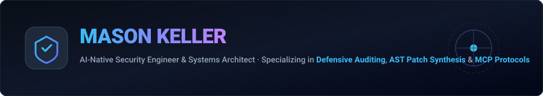
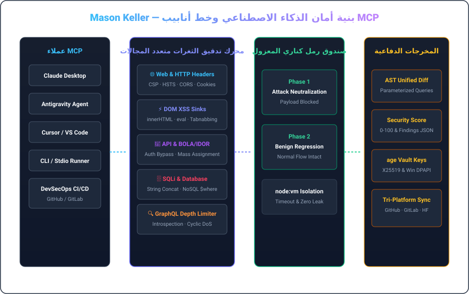
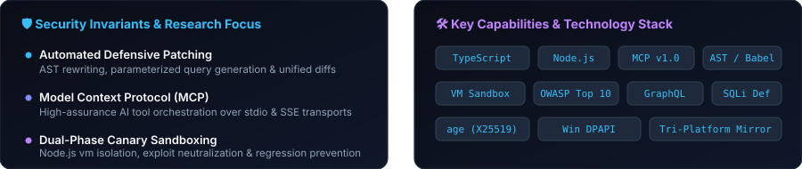

  <a href="../README.md">🇺🇸 English</a> &nbsp;•&nbsp; <a href="./README.ko.md">🇰🇷 한국어</a> &nbsp;•&nbsp; <a href="./README.ja.md">🇯🇵 日本語</a> &nbsp;•&nbsp; <a href="./README.zh.md">🇨🇳 简体中文</a> &nbsp;•&nbsp; <a href="./README.es.md">🇪🇸 Español</a> 
  <a href="./README.fr.md">🇫🇷 Français</a> &nbsp;•&nbsp; <a href="./README.de.md">🇩🇪 Deutsch</a> &nbsp;•&nbsp; <a href="./README.ru.md">🇷🇺 Русский</a> &nbsp;•&nbsp; <a href="./README.pt-BR.md">🇧🇷 Português</a> &nbsp;•&nbsp; <strong>🇸🇦 العربية</strong>

  

 

### 💡 نظرة عامة تنفيذية (Executive Overview)

مرحباً، أنا **مايسون كيلر (Mason Keller)** — مهندس أمن سيبراني بالذكاء الاصطناعي ومعماري أنظمة متخصص في التدقيق الآلي للثغرات، وتوليد التصحيحات الدفاعية على مستوى AST، وبروتوكول MCP، والبنية التحتية للتشفير الحديث.

أقوم بتصميم أنظمة تلتقي فيها **الرؤية الأمنية الدقيقة بالإصلاح الدفاعي الآلي**: من خوادم MCP عالية الموثوقية إلى بيئات الاختبار المعزولة (Canary Sandboxes) وخزائن التشفير المقاومة للحوسبة الكمومية.

---

  

### 🏛️ الركائز الهندسية والبنى الأساسية

#### 1. 🛡️ أبحاث الثغرات بالذكاء الاصطناعي وتوليد تصحيحات AST
- **تدقيق أمني متعدد المجالات**: فحص دقيق لترويسات HTTP (CSP, HSTS, CORS)، ومصارف DOM XSS، وثغرات REST/GraphQL، وحقن SQL.
- **إعادة كتابة كود AST**: تحويل الاستعلامات تلقائياً إلى صيغ مجهزة بالمعاملات (Parameterized)، وتطهير مدخلات DOM، وتوليد Unified Diff.
- **حماية GraphQL**: تقييد عمق الاستعلامات لمنع هجمات حجب الخدمة الدورية وتعطيل الاستبطان في بيئة الإنتاج.

#### 2. ⚡ بروتوكول سياق النموذج (MCP) وبيئات تشغيل الوكلاء
- **تكامل أدوات الذكاء الاصطناعي**: التزام كامل بمواصفات MCP v1.0 عبر قنوات stdio و SSE مع التحقق الصارم عبر Zod.
- **صندوق رمل كناري ثنائي المراحل**: بيئة افتراضية معزولة للتأكد من حظر الهجمات بنسبة 100% مع ضمان سلامة العمليات الطبيعية.
- **إشراف عالي الموثوقية على العمليات**: منع العمليات المعلقة (Zero-Zombie) واحتواء المهل الزمنية.

#### 3. 🔐 الموثوقية التشفيرية وخزائن الأمان المقاومة للكم
- **تشفير فلسفة UNIX**: استخدام `age` (X25519) و Minisign (Ed25519) للتشفير عالي الكفاءة والتحقق من التوقيعات.
- **حماية هجينة لمرحلة ما بعد الكم**: تغليف المفاتيح عبر ML-KEM-768 (Kyber) لضمان سرية سجلات التدقيق للمستقبل.
- **عزل المفاتيح المرتبط بالعتاد**: تشفير Windows DPAPI لمنع تسرب البيانات السرية بالنص الصريح.

---

### 💻 الحزمة التقنية الشاملة

| Domain | Core Technologies &amp; Tooling |
| :--- | :--- |
| **Languages &amp; Runtimes** | `TypeScript`, `Node.js`, `Rust`, `Go`, `Python`, `Shell (Bash / PowerShell)`, `SQL` |
| **AI Protocols &amp; MCP** | `Model Context Protocol (MCP v1.0)`, `Stdio / SSE Transports`, `Zod Schema Validation`, `Tool Orchestration` |
| **Defensive Security &amp; Auditing** | `OWASP Top 10`, `CSP / HSTS / CORS Headers`, `DOM XSS Sinks`, `BOLA / IDOR Analysis`, `SQLi AST Parameterization` |
| **Sandbox &amp; Execution Isolation** | `Node.js node:vm Sandboxing`, `Dual-Phase Canary Execution`, `Regression Verification`, `Timeout Guarding` |
| **Cryptography &amp; Secrets** | `age (X25519) UNIX Encryption`, `Minisign (Ed25519)`, `Post-Quantum (ML-KEM-768 / Kyber)`, `Windows DPAPI` |
| **CI/CD &amp; Multi-Platform Sync** | `GitHub Actions`, `Tri-Platform Mirroring (GitHub · GitLab · Hugging Face)`, `SemVer Releases` |

---

### 📁 الأنظمة المميزة والمستودعات المعمارية

- **[`vulnforge-mcp`](https://github.com/mason-keller/vulnforge-mcp)** — Universal AI-Native Web, API &amp; Database Vulnerability Auditing with Automated Patch Injection MCP Server (v1.2.0). Features 7 core MCP tools, AST query parameterization, and isolated VM canary testing.
- **[`canary-sandbox-engine`](https://github.com/mason-keller/vulnforge-mcp)** — Lightweight VM-isolated dual-phase execution sandbox that verifies attack payload neutralization and guarantees zero functional regression before applying patches.
- **[`crypto-vault-age`](https://github.com/mason-keller/vulnforge-mcp)** — UNIX-philosophy cryptographic protection suite combining age (X25519), Ed25519 detached signatures, and Windows DPAPI hardware binding.
- **[`devsecops-pipeline`](https://github.com/mason-keller/vulnforge-mcp)** — Automated multi-platform mirroring and real-time dependency auditing across GitHub, GitLab, and Hugging Face.

---

  

    
  <i>"الأمن ليس مجرد رقعة برمجية تطبق لاحقاً، بل هو مبدأ تأسيسي راسخ في معمارية البرمجيات."</i>

