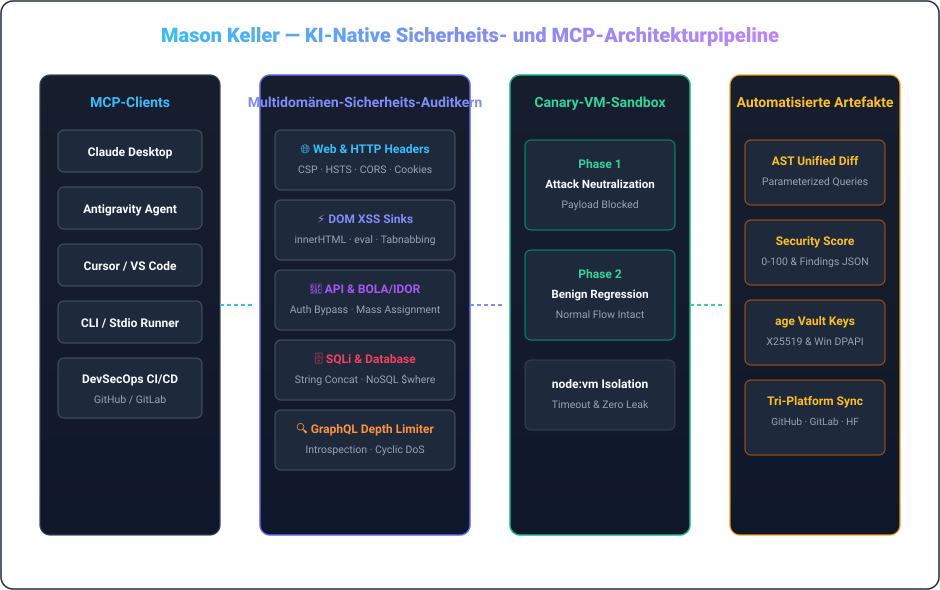

  <a href="../README.md">🇺🇸 English</a> &nbsp;•&nbsp; <a href="./README.ko.md">🇰🇷 한국어</a> &nbsp;•&nbsp; <a href="./README.ja.md">🇯🇵 日本語</a> &nbsp;•&nbsp; <a href="./README.zh.md">🇨🇳 简体中文</a> &nbsp;•&nbsp; <a href="./README.es.md">🇪🇸 Español</a> 
  <a href="./README.fr.md">🇫🇷 Français</a> &nbsp;•&nbsp; <strong>🇩🇪 Deutsch</strong> &nbsp;•&nbsp; <a href="./README.ru.md">🇷🇺 Русский</a> &nbsp;•&nbsp; <a href="./README.pt-BR.md">🇧🇷 Português</a> &nbsp;•&nbsp; <a href="./README.ar.md">🇸🇦 العربية</a>

  

 

### 💡 Leitende Übersicht (Executive Overview)

Hallo, ich bin **Mason Keller** — KI-nativer Sicherheitsingenieur und Systemarchitekt, spezialisiert auf automatisierte Schwachstellenaudits, AST-basierte defensive Patch-Synthese, Model Context Protocol (MCP) und moderne Kryptographie.

Ich entwerfe Architekturen, in denen **offensive Sicherheitserkennung auf automatisierte defensive Behebung trifft**: von MCP-Sicherheitsservern über isolierte Canary-Ausführungs-Sandboxes bis hin zu quantenresistenten Schlüsseltresoren.

---

  

### 🏛️ Technische Säulen & Kernarchitekturen

#### 1. 🛡️ KI-native Schwachstellenforschung & AST-Patch-Synthese
- **Multidomänen-Audits**: Tiefeninspektion von HTTP-Headern (CSP, HSTS, CORS), DOM-XSS-Senken, REST/GraphQL-BOLA/IDOR und SQL-Injection.
- **AST-Codetransformation**: Automatische Erstellung parametrisierter Abfragen, DOM-Bereinigung und Unified Diffs.
- **GraphQL-Schutz**: Abfragetiefenbegrenzung gegen zyklische DoS-Angriffe und Deaktivierung der Introspektion in Produktion.

#### 2. ⚡ Model Context Protocol (MCP) & Autonome Laufzeiten
- **Standardisierte KI-Tool-Integration**: Zuverlässige MCP v1.0-Implementierung über Stdio und SSE mit Zod-Validierung.
- **Zwei-Phasen-Canary-Sandbox**: Isolierte `node:vm`-Ausführungsumgebung zum Testen von Angriffsschutz und Regressionsfreiheit.
- **Prozess-Governance**: Saubere Beendigung aller Prozesse ohne verwaiste Hintergrundaufgaben (Zero-Zombie).

#### 3. 🔐 Kryptographische Zusicherung & Quantensichere Tresore
- **UNIX-Philosophie-Verschlüsselung**: Einsatz von `age` (X25519) und Minisign (Ed25519) für losgelöste Signaturen.
- **Post-Quanten-Schutz**: ML-KEM-768 (Kyber) Schlüsselkapselung für langfristige Audit-Sicherheit.
- **Hardwaregebundene Geheimhaltung**: Windows DPAPI-Verschlüsselung zur Beseitigung von Klartext-Schlüsseln.

---

### 💻 Umfassender Technologie-Stack

| Domain | Core Technologies &amp; Tooling |
| :--- | :--- |
| **Languages &amp; Runtimes** | `TypeScript`, `Node.js`, `Rust`, `Go`, `Python`, `Shell (Bash / PowerShell)`, `SQL` |
| **AI Protocols &amp; MCP** | `Model Context Protocol (MCP v1.0)`, `Stdio / SSE Transports`, `Zod Schema Validation`, `Tool Orchestration` |
| **Defensive Security &amp; Auditing** | `OWASP Top 10`, `CSP / HSTS / CORS Headers`, `DOM XSS Sinks`, `BOLA / IDOR Analysis`, `SQLi AST Parameterization` |
| **Sandbox &amp; Execution Isolation** | `Node.js node:vm Sandboxing`, `Dual-Phase Canary Execution`, `Regression Verification`, `Timeout Guarding` |
| **Cryptography &amp; Secrets** | `age (X25519) UNIX Encryption`, `Minisign (Ed25519)`, `Post-Quantum (ML-KEM-768 / Kyber)`, `Windows DPAPI` |
| **CI/CD &amp; Multi-Platform Sync** | `GitHub Actions`, `Tri-Platform Mirroring (GitHub · GitLab · Hugging Face)`, `SemVer Releases` |

---

### 📁 Ausgewählte Systeme & Architektur-Repositories

- **[`vulnforge-mcp`](https://github.com/mason-keller/vulnforge-mcp)** — Universal AI-Native Web, API &amp; Database Vulnerability Auditing with Automated Patch Injection MCP Server (v1.2.0). Features 7 core MCP tools, AST query parameterization, and isolated VM canary testing.
- **[`canary-sandbox-engine`](https://github.com/mason-keller/vulnforge-mcp)** — Lightweight VM-isolated dual-phase execution sandbox that verifies attack payload neutralization and guarantees zero functional regression before applying patches.
- **[`crypto-vault-age`](https://github.com/mason-keller/vulnforge-mcp)** — UNIX-philosophy cryptographic protection suite combining age (X25519), Ed25519 detached signatures, and Windows DPAPI hardware binding.
- **[`devsecops-pipeline`](https://github.com/mason-keller/vulnforge-mcp)** — Automated multi-platform mirroring and real-time dependency auditing across GitHub, GitLab, and Hugging Face.

---

  

    
  <i>"Sicherheit ist kein nachträglich angebrachter Patch, sondern eine grundlegende Invariante der Softwarearchitektur."</i>

