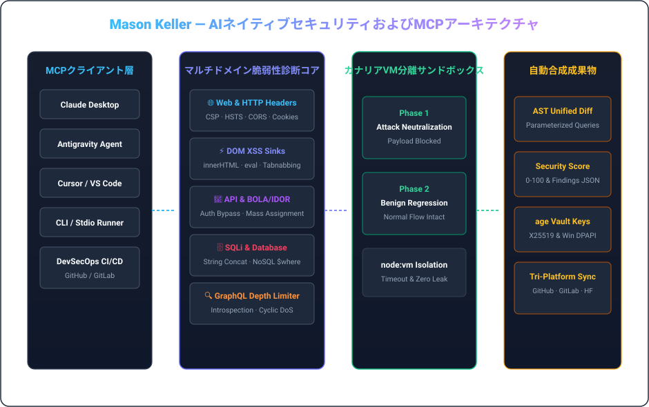

  <a href="../README.md">🇺🇸 English</a> &nbsp;•&nbsp; <a href="./README.ko.md">🇰🇷 한국어</a> &nbsp;•&nbsp; <strong>🇯🇵 日本語</strong> &nbsp;•&nbsp; <a href="./README.zh.md">🇨🇳 简体中文</a> &nbsp;•&nbsp; <a href="./README.es.md">🇪🇸 Español</a> 
  <a href="./README.fr.md">🇫🇷 Français</a> &nbsp;•&nbsp; <a href="./README.de.md">🇩🇪 Deutsch</a> &nbsp;•&nbsp; <a href="./README.ru.md">🇷🇺 Русский</a> &nbsp;•&nbsp; <a href="./README.pt-BR.md">🇧🇷 Português</a> &nbsp;•&nbsp; <a href="./README.ar.md">🇸🇦 العربية</a>

  

 

### 💡 エグゼクティブ概要 (Executive Overview)

こんにちは、**メイソン・ケラー (Mason Keller)** です。AIネイティブセキュリティエンジニアリング、AST構文解析ベースの防御パッチ自動合成、Model Context Protocol (MCP) ランタイム、および現代暗号基盤を専門としています。

脆弱性の精密な特定と**自動化された防御コード注入が融合した高信頼性システム**を設計します。WebヘッダーやDOMシンクを監査するMCPサーバーから、仮想マシン分離カナリアサンドボックス、耐量子暗号キー保管庫まで妥協のない堅牢性を追求します。

---

  

### 🏛️ コアエンジニアリングの柱とアーキテクチャ

#### 1. 🛡️ AIネイティブ脆弱性研究とASTパッチ合成
- **マルチドメインセキュリティ監査**: HTTPヘッダー (CSP, HSTS, CORS)、DOM XSSシンク、REST/GraphQL BOLA/IDOR、SQLインジェクションの深層診断。
- **ASTコード書き換え**: パラメータ化クエリへの自動変換、DOMサニタイズ、セキュリティミドルウェア注入、Unified Diff生成。
- **GraphQLクエリ深度＆DoS防御**: ネスト深度爆弾、エイリアス乱用、本番イントロスペクション漏洩の遮断。

#### 2. ⚡ Model Context Protocol (MCP) とエージェントランタイム
- **標準化されたAIツール統合**: StdioおよびSSEトランスポートに対応したMCP v1.0仕様の完全準拠と厳格なZodスキーマ検証。
- **二相カナリアサンドボックス**: 分離環境で攻撃ペイロード遮断と既存機能の回帰防止を両立して検証。
- **プロセス監督とクリーン実行**: ゾンビプロセスの完全排除とリソースタイムアウト保護。

#### 3. 🔐 暗号技術による信頼性保証と耐量子ボールト
- **UNIX思想の暗号化**: `age` (X25519) および Minisign (Ed25519) による安全なファイル暗号化と署名検証。
- **耐量子ハイブリッド保護**: 長期監査証跡の機密性を担保する ML-KEM-768 (Kyber) キーカプセル化。
- **ハードウェアバインドシークレット**: Windows DPAPIによる平文漏洩ゼロの保護基盤。

---

### 💻 包括的テクノロジースタック

| Domain | Core Technologies &amp; Tooling |
| :--- | :--- |
| **Languages &amp; Runtimes** | `TypeScript`, `Node.js`, `Rust`, `Go`, `Python`, `Shell (Bash / PowerShell)`, `SQL` |
| **AI Protocols &amp; MCP** | `Model Context Protocol (MCP v1.0)`, `Stdio / SSE Transports`, `Zod Schema Validation`, `Tool Orchestration` |
| **Defensive Security &amp; Auditing** | `OWASP Top 10`, `CSP / HSTS / CORS Headers`, `DOM XSS Sinks`, `BOLA / IDOR Analysis`, `SQLi AST Parameterization` |
| **Sandbox &amp; Execution Isolation** | `Node.js node:vm Sandboxing`, `Dual-Phase Canary Execution`, `Regression Verification`, `Timeout Guarding` |
| **Cryptography &amp; Secrets** | `age (X25519) UNIX Encryption`, `Minisign (Ed25519)`, `Post-Quantum (ML-KEM-768 / Kyber)`, `Windows DPAPI` |
| **CI/CD &amp; Multi-Platform Sync** | `GitHub Actions`, `Tri-Platform Mirroring (GitHub · GitLab · Hugging Face)`, `SemVer Releases` |

---

### 📁 注目のシステムおよびリポジトリ

- **[`vulnforge-mcp`](https://github.com/mason-keller/vulnforge-mcp)** — Universal AI-Native Web, API &amp; Database Vulnerability Auditing with Automated Patch Injection MCP Server (v1.2.0). Features 7 core MCP tools, AST query parameterization, and isolated VM canary testing.
- **[`canary-sandbox-engine`](https://github.com/mason-keller/vulnforge-mcp)** — Lightweight VM-isolated dual-phase execution sandbox that verifies attack payload neutralization and guarantees zero functional regression before applying patches.
- **[`crypto-vault-age`](https://github.com/mason-keller/vulnforge-mcp)** — UNIX-philosophy cryptographic protection suite combining age (X25519), Ed25519 detached signatures, and Windows DPAPI hardware binding.
- **[`devsecops-pipeline`](https://github.com/mason-keller/vulnforge-mcp)** — Automated multi-platform mirroring and real-time dependency auditing across GitHub, GitLab, and Hugging Face.

---

  

    
  <i>「セキュリティとは事後に対処するパッチではなく、ソフトウェアアーキテクチャの根本的な不変条件である。」</i>

