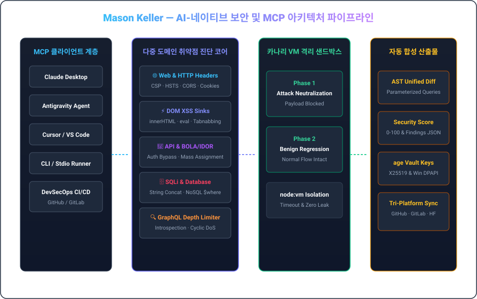

  <a href="../README.md">🇺🇸 English</a> &nbsp;•&nbsp; <strong>🇰🇷 한국어</strong> &nbsp;•&nbsp; <a href="./README.ja.md">🇯🇵 日本語</a> &nbsp;•&nbsp; <a href="./README.zh.md">🇨🇳 简体中文</a> &nbsp;•&nbsp; <a href="./README.es.md">🇪🇸 Español</a> 
  <a href="./README.fr.md">🇫🇷 Français</a> &nbsp;•&nbsp; <a href="./README.de.md">🇩🇪 Deutsch</a> &nbsp;•&nbsp; <a href="./README.ru.md">🇷🇺 Русский</a> &nbsp;•&nbsp; <a href="./README.pt-BR.md">🇧🇷 Português</a> &nbsp;•&nbsp; <a href="./README.ar.md">🇸🇦 العربية</a>

  

 

### 💡 핵심 개요 (Executive Overview)

안녕하세요, **메이슨 켈러 (Mason Keller)**입니다. AI-네이티브 보안 엔지니어링, AST 구문 분석 기반 방어 패치 자동 합성, 모델 컨텍스트 프로토콜(MCP) 런타임 및 현대 암호학 인프라를 전문으로 설계하고 구축합니다.

공격자 관점의 정밀 진단과 **자동화된 방어적 코드 주입이 결합된 고신뢰성 소프트웨어 아키텍처**를 추구합니다. 웹 보안 헤더와 클라이언트 DOM 싱크를 심층 진단하는 MCP 보안 서버부터 `node:vm` 격리 카나리 샌드박스, 그리고 양자 내성 암호화 키 볼트에 이르기까지 타협 없는 무결성을 만듭니다.

---

  

### 🏛️ 핵심 엔지니어링 기둥 & 아키텍처

#### 1. 🛡️ AI-네이티브 취약점 분석 및 AST 방어 패치 합성
- **다중 도메인 보안 진단**: HTTP 보안 헤더(CSP, HSTS, CORS), DOM XSS 싱크(`innerHTML`, `eval`), REST/GraphQL BOLA/IDOR 및 SQL 인젝션 문자열 연결 취약점 전수 진단.
- **AST 구문 트리 재작성**: 매개변수화 쿼리 자동 변환, DOM 텍스트 정화, 보안 미들웨어 주입 및 Unified Diff 자동 생성.
- **GraphQL 쿼리 심층도 및 DoS 방어**: 중첩 쿼리 폭탄(Depth Limiter), 별칭 남용 및 프로덕션 인트로스펙션 노출 차단.

#### 2. ⚡ 모델 컨텍스트 프로토콜 (MCP) & 자율 에이전트 런타임
- **표준 AI 도구 오케스트레이션**: Stdio 및 SSE 전송 계층 기반 MCP v1.0 스펙 완벽 준수 및 엄격한 Zod 스키마 검증.
- **이중 위상(Dual-Phase) 카나리 샌드박스**: 가상머신 격리 환경에서 공격 페이로드 차단 여부와 정상 기능 회귀 무결성을 동시 검증.
- **프로세스 수퍼바이저 & 제로 좀비**: 타임아웃 격리, 비정상 잔류 프로세스 전수 소거(Zero-Zombie) 및 무결성 보장.

#### 3. 🔐 암호학적 신뢰성 보장 & 양자 내성 보안 볼트
- **UNIX 철학 암호화**: 레거시 PGP를 대체하는 초경량 `age` (X25519) 및 Minisign (Ed25519) 분리 서명 체계 운용.
- **양자 내성 하이브리드 보호**: 장기 보관 감사 로그의 기밀성을 보장하는 ML-KEM-768 (Kyber) 하이브리드 키 캡슐화.
- **하드웨어 바인딩 시크릿 격리**: Windows DPAPI 하드웨어 암호화 및 파일시스템 접근 제어를 통한 시크릿 제로 누출.

---

### 💻 기술 스택 및 엔지니어링 도구

| Domain | Core Technologies &amp; Tooling |
| :--- | :--- |
| **Languages &amp; Runtimes** | `TypeScript`, `Node.js`, `Rust`, `Go`, `Python`, `Shell (Bash / PowerShell)`, `SQL` |
| **AI Protocols &amp; MCP** | `Model Context Protocol (MCP v1.0)`, `Stdio / SSE Transports`, `Zod Schema Validation`, `Tool Orchestration` |
| **Defensive Security &amp; Auditing** | `OWASP Top 10`, `CSP / HSTS / CORS Headers`, `DOM XSS Sinks`, `BOLA / IDOR Analysis`, `SQLi AST Parameterization` |
| **Sandbox &amp; Execution Isolation** | `Node.js node:vm Sandboxing`, `Dual-Phase Canary Execution`, `Regression Verification`, `Timeout Guarding` |
| **Cryptography &amp; Secrets** | `age (X25519) UNIX Encryption`, `Minisign (Ed25519)`, `Post-Quantum (ML-KEM-768 / Kyber)`, `Windows DPAPI` |
| **CI/CD &amp; Multi-Platform Sync** | `GitHub Actions`, `Tri-Platform Mirroring (GitHub · GitLab · Hugging Face)`, `SemVer Releases` |

---

### 📁 주요 시스템 및 아키텍처 저장소

- **[`vulnforge-mcp`](https://github.com/mason-keller/vulnforge-mcp)** — Universal AI-Native Web, API &amp; Database Vulnerability Auditing with Automated Patch Injection MCP Server (v1.2.0). Features 7 core MCP tools, AST query parameterization, and isolated VM canary testing.
- **[`canary-sandbox-engine`](https://github.com/mason-keller/vulnforge-mcp)** — Lightweight VM-isolated dual-phase execution sandbox that verifies attack payload neutralization and guarantees zero functional regression before applying patches.
- **[`crypto-vault-age`](https://github.com/mason-keller/vulnforge-mcp)** — UNIX-philosophy cryptographic protection suite combining age (X25519), Ed25519 detached signatures, and Windows DPAPI hardware binding.
- **[`devsecops-pipeline`](https://github.com/mason-keller/vulnforge-mcp)** — Automated multi-platform mirroring and real-time dependency auditing across GitHub, GitLab, and Hugging Face.

---

  

    
  <i>"보안은 사후에 덧대는 패치가 아니라, 소프트웨어 아키텍처의 근본적인 불변식입니다."</i>

