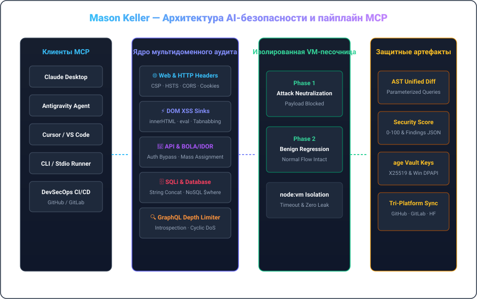

  <a href="../README.md">🇺🇸 English</a> &nbsp;•&nbsp; <a href="./README.ko.md">🇰🇷 한국어</a> &nbsp;•&nbsp; <a href="./README.ja.md">🇯🇵 日本語</a> &nbsp;•&nbsp; <a href="./README.zh.md">🇨🇳 简体中文</a> &nbsp;•&nbsp; <a href="./README.es.md">🇪🇸 Español</a> 
  <a href="./README.fr.md">🇫🇷 Français</a> &nbsp;•&nbsp; <a href="./README.de.md">🇩🇪 Deutsch</a> &nbsp;•&nbsp; <strong>🇷🇺 Русский</strong> &nbsp;•&nbsp; <a href="./README.pt-BR.md">🇧🇷 Português</a> &nbsp;•&nbsp; <a href="./README.ar.md">🇸🇦 العربية</a>

  

 

### 💡 Обзор деятельности (Executive Overview)

Привет, я **Мейсон Келлер (Mason Keller)** — инженер по AI-безопасности и системный архитектор. Моя специализация — автоматизированный аудит уязвимостей, синтез защитных патчей на уровне AST, протокол MCP и современные криптографические хранилища.

Я создаю системы, где **глубокий аудит безопасности объединяется с автоматическим исправлением**: от MCP-серверов до изолированных канареечных песочниц и постквантовых криптографических хранилищ.

---

  

### 🏛️ Инженерные принципы и ключевая архитектура

#### 1. 🛡️ Аудит уязвимостей с AI и синтез AST-патчей
- **Мультидоменный аудит**: Проверка HTTP-заголовков (CSP, HSTS, CORS), DOM XSS стоков (`innerHTML`, `eval`), REST/GraphQL BOLA/IDOR и SQLi.
- **Синтез патчей на уровне AST**: Автоматическое создание параметризованных запросов, санация DOM и генерация Unified Diff.
- **Защита GraphQL**: Ограничение глубины запросов против циклических DoS-атак и блокировка интроспекции в продакшене.

#### 2. ⚡ Model Context Protocol (MCP) и среда выполнения агентов
- **Стандартизированная оркестрация**: Реализация спецификации MCP v1.0 через stdio и SSE со строгой валидацией Zod.
- **Двухфазная канареечная песочница**: Изолированное тестирование в `node:vm` для подтверждения блокировки атак и отсутствия регрессий.
- **Надежность процессов**: Полное исключение зомби-процессов и гарантированное время отклика.

#### 3. 🔐 Криптографическая стойкость и постквантовые хранилища
- **Криптография философии UNIX**: Использование `age` (X25519) и Minisign (Ed25519) для надежной защиты данных.
- **Постквантовая безопасность**: Гибридное инкапсулирование ключей ML-KEM-768 (Kyber) для защиты журнала аудита.
- **Аппаратная привязка**: Шифрование Windows DPAPI, исключающее утечку секретов в открытом виде.

---

### 💻 Полный технологический стек

| Domain | Core Technologies &amp; Tooling |
| :--- | :--- |
| **Languages &amp; Runtimes** | `TypeScript`, `Node.js`, `Rust`, `Go`, `Python`, `Shell (Bash / PowerShell)`, `SQL` |
| **AI Protocols &amp; MCP** | `Model Context Protocol (MCP v1.0)`, `Stdio / SSE Transports`, `Zod Schema Validation`, `Tool Orchestration` |
| **Defensive Security &amp; Auditing** | `OWASP Top 10`, `CSP / HSTS / CORS Headers`, `DOM XSS Sinks`, `BOLA / IDOR Analysis`, `SQLi AST Parameterization` |
| **Sandbox &amp; Execution Isolation** | `Node.js node:vm Sandboxing`, `Dual-Phase Canary Execution`, `Regression Verification`, `Timeout Guarding` |
| **Cryptography &amp; Secrets** | `age (X25519) UNIX Encryption`, `Minisign (Ed25519)`, `Post-Quantum (ML-KEM-768 / Kyber)`, `Windows DPAPI` |
| **CI/CD &amp; Multi-Platform Sync** | `GitHub Actions`, `Tri-Platform Mirroring (GitHub · GitLab · Hugging Face)`, `SemVer Releases` |

---

### 📁 Избранные системы и репозитории

- **[`vulnforge-mcp`](https://github.com/mason-keller/vulnforge-mcp)** — Universal AI-Native Web, API &amp; Database Vulnerability Auditing with Automated Patch Injection MCP Server (v1.2.0). Features 7 core MCP tools, AST query parameterization, and isolated VM canary testing.
- **[`canary-sandbox-engine`](https://github.com/mason-keller/vulnforge-mcp)** — Lightweight VM-isolated dual-phase execution sandbox that verifies attack payload neutralization and guarantees zero functional regression before applying patches.
- **[`crypto-vault-age`](https://github.com/mason-keller/vulnforge-mcp)** — UNIX-philosophy cryptographic protection suite combining age (X25519), Ed25519 detached signatures, and Windows DPAPI hardware binding.
- **[`devsecops-pipeline`](https://github.com/mason-keller/vulnforge-mcp)** — Automated multi-platform mirroring and real-time dependency auditing across GitHub, GitLab, and Hugging Face.

---

  

    
  <i>«Безопасность — это не заплатка, наложенная задним числом, а фундаментальный инвариант архитектуры ПО.»</i>

