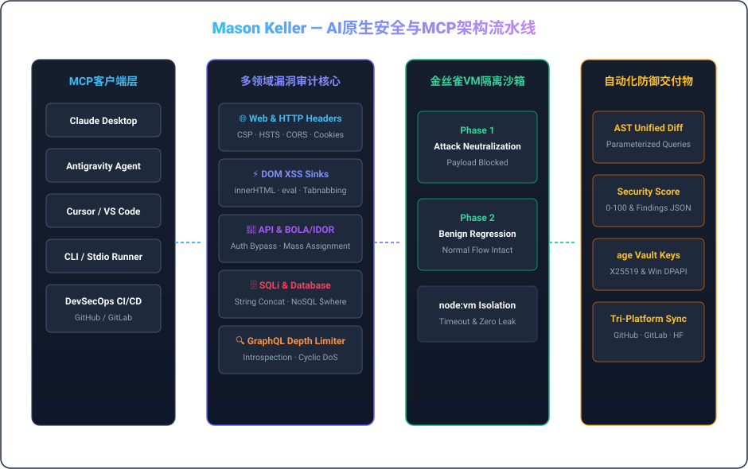

  <a href="../README.md">🇺🇸 English</a> &nbsp;•&nbsp; <a href="./README.ko.md">🇰🇷 한국어</a> &nbsp;•&nbsp; <a href="./README.ja.md">🇯🇵 日本語</a> &nbsp;•&nbsp; <strong>🇨🇳 简体中文</strong> &nbsp;•&nbsp; <a href="./README.es.md">🇪🇸 Español</a> 
  <a href="./README.fr.md">🇫🇷 Français</a> &nbsp;•&nbsp; <a href="./README.de.md">🇩🇪 Deutsch</a> &nbsp;•&nbsp; <a href="./README.ru.md">🇷🇺 Русский</a> &nbsp;•&nbsp; <a href="./README.pt-BR.md">🇧🇷 Português</a> &nbsp;•&nbsp; <a href="./README.ar.md">🇸🇦 العربية</a>

  

 

### 💡 架构概述 (Executive Overview)

您好，我是 **Mason Keller** — 专注于AI原生安全工程、AST级防御性补丁自动合成、模型上下文协议 (MCP) 运行时以及现代密码学基础设施的系统架构师。

我致力于构建**攻击面深度感知与自动化防御修复深度融合的高可靠性软件系统**：从审计Web头部与DOM接收器的MCP安全服务器，到VM隔离金丝雀测试沙箱与抗量子密码金库。

---

  

### 🏛️ 核心工程支柱与系统架构

#### 1. 🛡️ AI原生漏洞审计与AST防御补丁合成
- **全方位安全审计**: 深入检查HTTP标头 (CSP, HSTS, CORS)、客户端DOM XSS接收器、REST/GraphQL越权漏洞 (BOLA/IDOR) 及SQL注入。
- **AST语法树重写**: 自动生成参数化查询、DOM文本净化代码与安全中间件，并输出标准化Unified Diff。
- **GraphQL深度与DoS防御**: 实时拦截循环查询深度炸弹、别名滥用与生产环境内省暴露。

#### 2. ⚡ 模型上下文协议 (MCP) 与自主智能体运行时
- **标准化AI工具编排**: 严格遵循MCP v1.0协议规范，全面支持stdio与SSE传输通道及Zod数据校验。
- **双阶段金丝雀沙箱**: 在轻量级隔离容器中同时验证攻击拦截能力与核心业务回归完整性。
- **系统级进程监管**: 严格杜绝僵尸进程残留，保障低延迟、高并发工具调用。

#### 3. 🔐 密码学信任机制与后量子安全金库
- **UNIX哲学密码学**: 采用现代轻量级 `age` (X25519) 与 Minisign (Ed25519) 进行代码签名与数据加密。
- **抗量子混合密钥保护**: 引入 ML-KEM-768 (Kyber) 密钥封装机制，确保审计数据的长期安全性。
- **硬件绑定凭据隔离**: 结合 Windows DPAPI 硬件加密，实现敏感密钥零明文泄露。

---

### 💻 核心技术栈与工程工具

| Domain | Core Technologies &amp; Tooling |
| :--- | :--- |
| **Languages &amp; Runtimes** | `TypeScript`, `Node.js`, `Rust`, `Go`, `Python`, `Shell (Bash / PowerShell)`, `SQL` |
| **AI Protocols &amp; MCP** | `Model Context Protocol (MCP v1.0)`, `Stdio / SSE Transports`, `Zod Schema Validation`, `Tool Orchestration` |
| **Defensive Security &amp; Auditing** | `OWASP Top 10`, `CSP / HSTS / CORS Headers`, `DOM XSS Sinks`, `BOLA / IDOR Analysis`, `SQLi AST Parameterization` |
| **Sandbox &amp; Execution Isolation** | `Node.js node:vm Sandboxing`, `Dual-Phase Canary Execution`, `Regression Verification`, `Timeout Guarding` |
| **Cryptography &amp; Secrets** | `age (X25519) UNIX Encryption`, `Minisign (Ed25519)`, `Post-Quantum (ML-KEM-768 / Kyber)`, `Windows DPAPI` |
| **CI/CD &amp; Multi-Platform Sync** | `GitHub Actions`, `Tri-Platform Mirroring (GitHub · GitLab · Hugging Face)`, `SemVer Releases` |

---

### 📁 精选开源系统与代表性存储库

- **[`vulnforge-mcp`](https://github.com/mason-keller/vulnforge-mcp)** — Universal AI-Native Web, API &amp; Database Vulnerability Auditing with Automated Patch Injection MCP Server (v1.2.0). Features 7 core MCP tools, AST query parameterization, and isolated VM canary testing.
- **[`canary-sandbox-engine`](https://github.com/mason-keller/vulnforge-mcp)** — Lightweight VM-isolated dual-phase execution sandbox that verifies attack payload neutralization and guarantees zero functional regression before applying patches.
- **[`crypto-vault-age`](https://github.com/mason-keller/vulnforge-mcp)** — UNIX-philosophy cryptographic protection suite combining age (X25519), Ed25519 detached signatures, and Windows DPAPI hardware binding.
- **[`devsecops-pipeline`](https://github.com/mason-keller/vulnforge-mcp)** — Automated multi-platform mirroring and real-time dependency auditing across GitHub, GitLab, and Hugging Face.

---

  

    
  <i>“安全绝不是事后修补的补丁，而是软件架构不可动摇的基本不变量。”</i>

